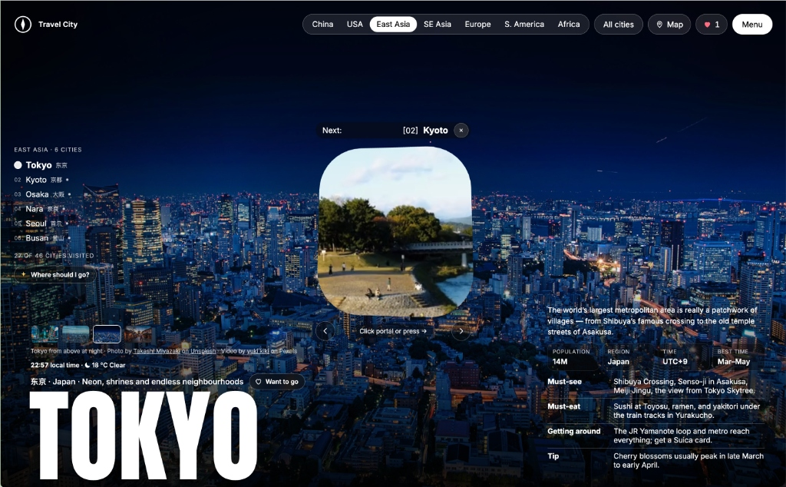
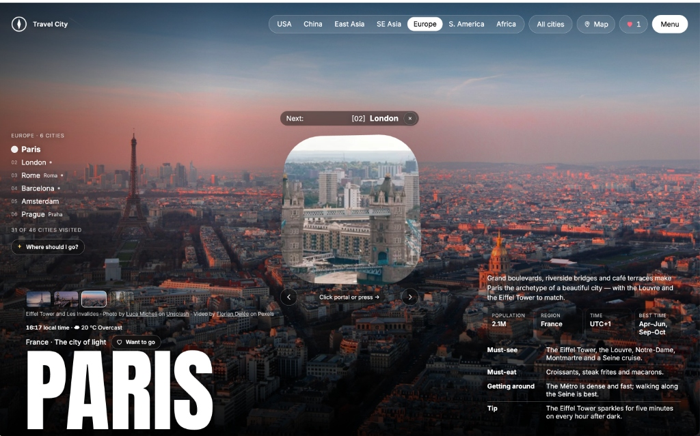
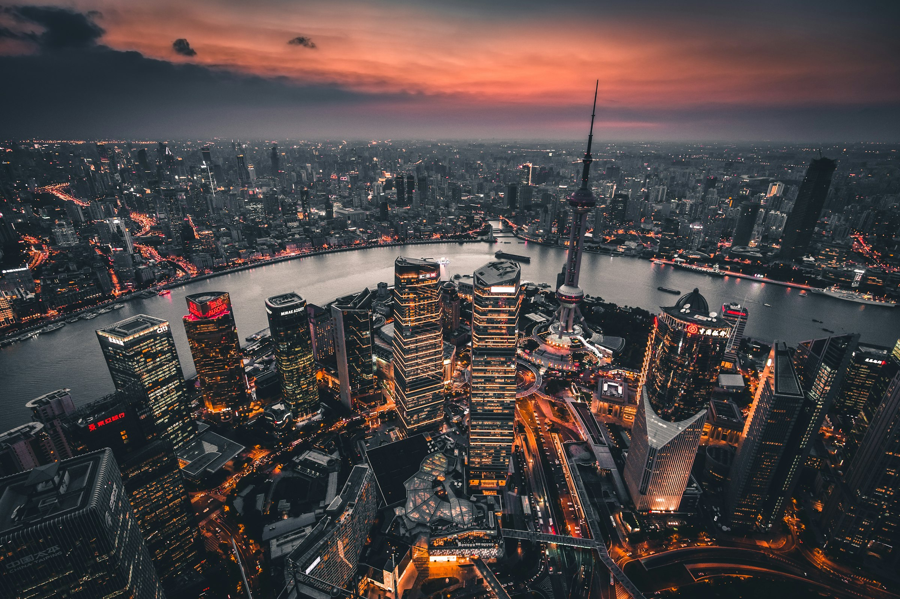
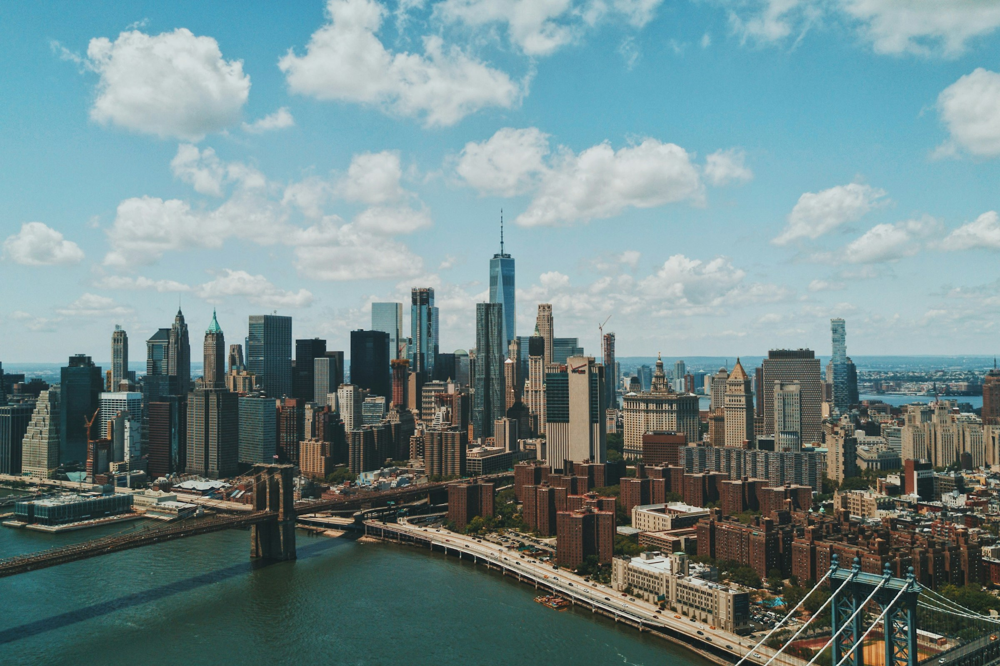
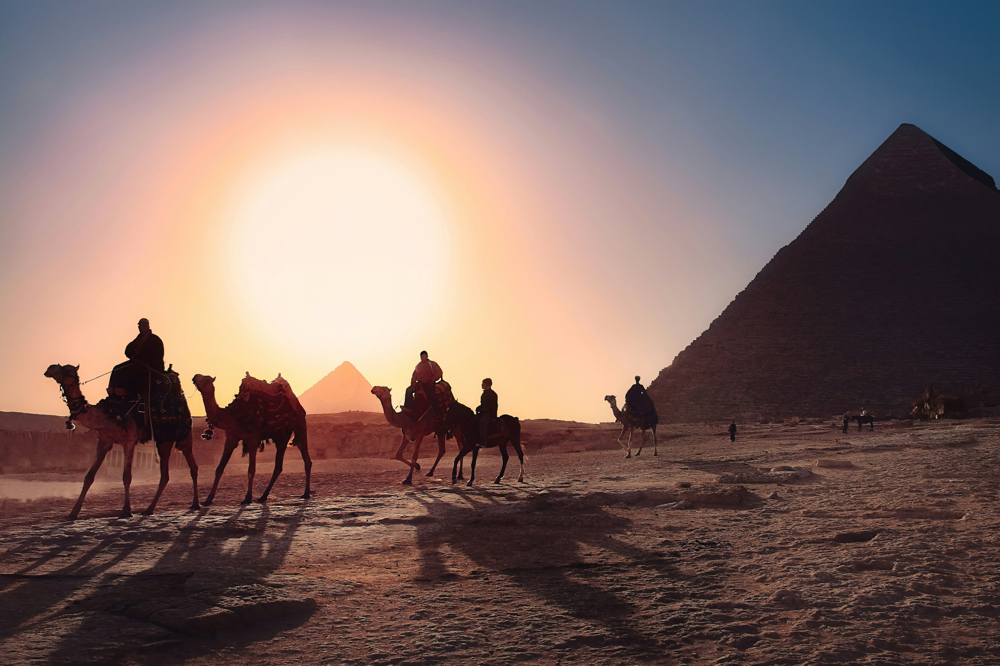
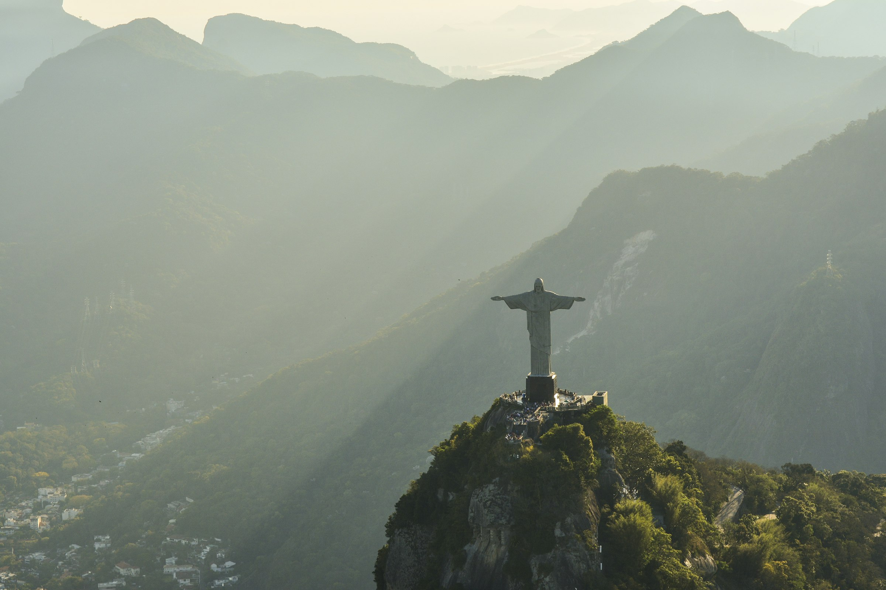
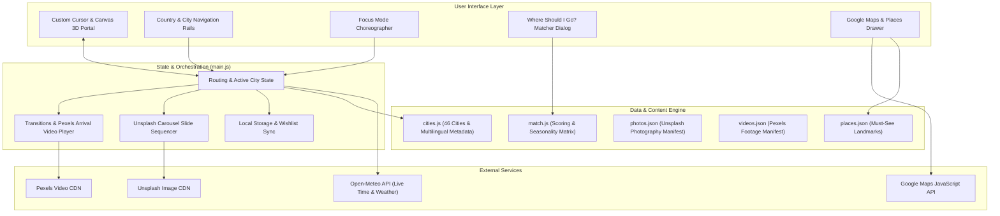

<p align="center">
  <svg width="64" height="64" viewBox="0 0 40 40" fill="none" xmlns="http://www.w3.org/2000/svg">
    <circle cx="20" cy="20" r="18" stroke="#ffffff" stroke-width="2"/>
    <path d="M20 6l4.5 14L20 34l-4.5-14z" fill="#ffffff"/>
    <circle cx="20" cy="20" r="2.4" fill="#000000"/>
  </svg>
</p>

<h1 align="center">Travel City (Space Voyage)</h1>

<p align="center">Step through a perspective 3D portal between 46 curated cities across five continents.</p>

<p align="center">
  <a href="#key-features">Key Features</a> ·
  <a href="#destinations-matrix">46 Destinations</a> ·
  <a href="#interactive-features">Interactive Experience</a> ·
  <a href="#architecture">Architecture</a> ·
  <a href="#getting-started">Getting Started</a>
</p>

<p align="center">
  
  
</p>

**Travel City** is an immersive single-page web experience blending canvas-driven 3D portal navigation, arrival drone cinematography, high-resolution photography, live global weather, and curated travel intelligence for **46 world destinations** across seven major regions.

---

## Key Features

### 1. Canvas-Driven 3D Portal & Warp Transitions
* **Real-time 2D Canvas Perspective Portal**: Interactively previews the next upcoming destination through an organic rounded portal window.
* **Cinematic Arrival Footage**: Over 45 high-definition drone and street arrival clips from Pexels, alongside AI-generated flyovers (Seedance), playing during warp hops.
* **Multi-Input Controls**: Navigate smoothly using arrow keys (`←` / `→`), clickable warp portals, prev/next buttons, or touch swipe gestures.

### 2. Native Multi-Language Typography
* **Local Native Names**: Each city displays its English title alongside its native language and script (e.g. `Tokyo 東京`, `Kyoto 京都`, `Seoul 서울`, `Bangkok กรุงเทพฯ`, `Rome Roma`, `Prague Praha`, `Cairo القاهرة`, `Marrakech مراكش`).
* **Clean Single-Label Handling**: Regions with English as their primary language (USA) and European/Latin cities with identical native and English spellings (`London`, `Paris`, `Barcelona`, `Amsterdam`) cleanly show single names without redundant duplicate subtitles.
* **Typographic Font Shaping**: Script-aware `lang` tags (`lang="ja"`, `lang="ko"`, `lang="th"`, `lang="ar"`, `lang="zh"`, etc.) prevent CJK Han-unification fallback glitches.

### 3. Focus Mode & Distraction-Free Photography
* **One-Click Scrim Lift**: Close the portal with the `(x)` button to tuck the portal away, glide sidebar guides out of view, and enjoy unobstructed 4K city photography.
* **Dynamic Custom Cursor**: Precision-styled tracking cursor with subtle hover animations and state indicators.

### 4. Real-Time Telemetry & Weather
* **Open-Meteo Integration**: Live temperature, weather condition icons, and precise local times calculated dynamically from city IANA timezones.
* **Essential Travel Stats**: Population, administrative region, UTC offset, and recommended travel months for every stop.

### 5. "Where Should I Go?" Travel Matcher
* **Transparent Rule-Based Recommendation Engine**: Filter and score destinations based on travel interests (*Food, History & culture, Nature & views, City lights, Beaches & coast, Art & architecture, Family & theme parks*) and travel months.

### 6. Interactive Google Maps & Saved Itineraries
* **Curated Must-See Sights**: Handpicked landmarks and architectural wonders for every city with direct Google Maps deep-links.
* **Want to Go Shortlist**: Save favourite stops and sync saved itineraries seamlessly across tabs via local storage.

---

## Visual Walkthrough

| Tokyo, Japan (Night Portal) | Paris, France (Golden Hour) |
| :---: | :---: |
| <br><em>Interactive portal jumping to Kyoto with live local weather and East Asia drawer</em> | <br><em>Golden hour panoramic backdrop with Europe city roster and quick stats</em> |
| **Shanghai, China (The Bund)** | **New York, USA (Manhattan)** |
| <br><em>China regional collection with English and Chinese dual typography</em> | <br><em>First-order regional priority with clean English-only layout</em> |
| **Cairo, Egypt (Pyramids of Giza)** | **Rio de Janeiro, Brazil (Christ the Redeemer)** |
| <br><em>Arabic typography (القاهرة) and North African historic highlights</em> | <br><em>South American coastline wonders and vibrant cultural hubs</em> |

---

## Destinations Matrix

Travel City covers **46 cities** across **7 regions**:

| Region | Regional Header | Cities Included | Native Local Displays |
| :--- | :--- | :--- | :--- |
| **USA** | `USA` | New York, Orlando, Chicago, New Orleans, San Francisco, Washington, D.C., Nashville, Las Vegas | English only |
| **China** | `China` (中国) | Beijing, Xi’an, Shanghai, Chongqing, Shenzhen, Chengdu, Suzhou, Guilin | `北京`, `西安`, `上海`, `重庆`, `深圳`, `成都`, `苏州`, `桂林` |
| **East Asia** | `East Asia` (东亚) | Tokyo, Kyoto, Osaka, Nara, Seoul, Busan | `東京`, `京都`, `大阪`, `奈良`, `서울`, `부산` |
| **Southeast Asia** | `SE Asia` (东南亚) | Singapore, Bangkok, Chiang Mai, Hanoi, Kuala Lumpur, Siem Reap | `Singapura`, `กรุงเทพฯ`, `เชียงใหม่`, `Hà Nội`, `សៀមរាប` |
| **Europe** | `Europe` (欧洲) | Paris, London, Rome, Barcelona, Amsterdam, Prague | `Roma`, `Praha` |
| **South America** | `S. America` (南美洲) | Rio de Janeiro, Buenos Aires, Cusco, Lima, Cartagena, Santiago | `Qosqo` |
| **Africa** | `Africa` (非洲) | Cape Town, Marrakech, Cairo, Nairobi, Zanzibar, Victoria Falls | `Kaapstad`, `مراكش`, `القاهرة`, `زنجبار`, `Mosi-oa-Tunya` |

---

## Architecture



---

## Tech Stack

* **Build Tool**: [Vite 8](https://vitejs.dev/)
* **Runtime**: Vanilla ES Modules (Zero framework overhead for maximum render performance)
* **Rendering**: Canvas 2D Perspective Transformations, CSS Custom Properties & GPU Keyframe Animations
* **Telemetry**: [Open-Meteo API](https://open-meteo.com/) (Free, no API key required)
* **Maps**: Google Maps JavaScript API with graceful fallback
* **Assets**: Unsplash Photography + Pexels Drone Footage + Seedance Flyover

---

## Project Structure

```text
Space-Voyage/
├── docs/
│   └── screenshots/              # High-res walkthrough captures & highlights
├── travel-city/
│   ├── index.html                # App shell, modal dialogs, and SVG icons
│   ├── public/
│   │   ├── favicon.svg           # Brand vector compass icon
│   │   └── cities/               # 46 city asset bundles (images, thumbnails, arrival.mp4)
│   └── src/
│       ├── cities.js             # 46 cities dataset, country orders, and translations
│       ├── main.js               # Core controller, portal animation, audio/video loops
│       ├── map.js                # Google Maps integration and marker overlays
│       ├── match.js              # "Where should I go?" recommendation algorithm
│       ├── photos.json           # Unsplash photo credits and metadata
│       ├── places.json           # Must-see places and coordinates
│       ├── styles.css            # Responsive layout, typography, and dark theme
│       └── videos.json           # Pexels arrival video credits and metadata
├── package.json
└── vite.config.js
```

---

## Getting Started

### Prerequisites
* [Node.js](https://nodejs.org/) v18.0.0 or higher
* npm or pnpm

### 1. Clone the repository
```bash
git clone https://github.com/JiawenZhu/Space-Voyage.git
cd Space-Voyage
```

### 2. Install dependencies
```bash
npm install
```

### 3. Start local development server
```bash
npm run dev:travel
```
Open your browser and navigate to `http://localhost:3001`.

### 4. Build for production
```bash
npm run build:travel
```
Production assets will be built into `travel-city/dist/`.

---

## Keyboard Shortcuts

| Key | Action |
| :--- | :--- |
| <kbd>→</kbd> / <kbd>Space</kbd> / <kbd>Enter</kbd> | Travel to next city via the portal |
| <kbd>←</kbd> | Return to previous city |
| <kbd>Esc</kbd> | Close active modal dialog or exit focus mode |

---

## Credits & Attributions

* **Photography**: Curated from [Unsplash](https://unsplash.com) photographers, credited on each city card.
* **Cinematography**: Arrival footage by videographers on [Pexels](https://www.pexels.com); Shanghai skyline flyover generated with **Seedance**.
* **Weather & Telemetry**: Live temperatures and timezones powered by [Open-Meteo](https://open-meteo.com).
* **Geographical Knowledge**: Historical landmarks, municipal stats, and culinary notes cross-verified via Wikipedia.
